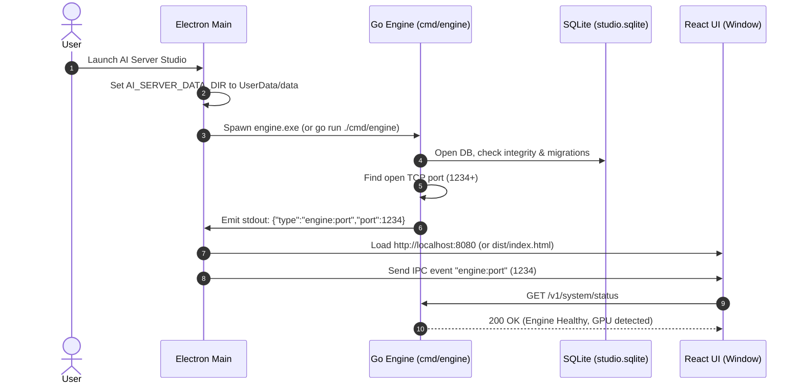
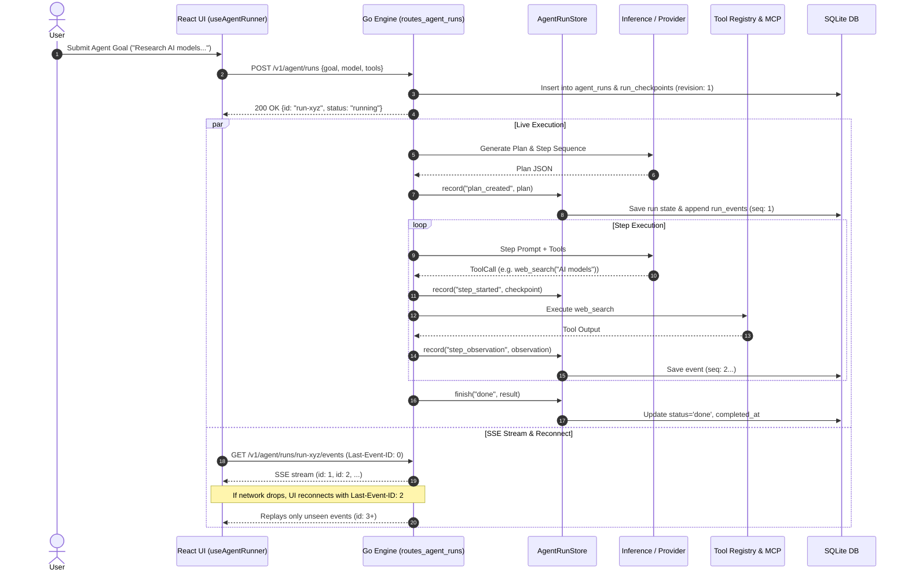

# AI Server Studio — Project Status, Architecture & How It Works

## 1. Executive Summary & Purpose

**AI Server Studio** is a local-first, privacy-centric desktop application designed for running, serving, and orchestrating local Large Language Models (LLMs) alongside cloud provider fallbacks.

The application combines:
1. **Desktop Shell:** Electron-hosted environment with native window controls, GPU acceleration support, and process supervision.
2. **Frontend UI:** Modern React 18 application built with TypeScript, Vite, Tailwind CSS, Radix UI / shadcn, and Zustand state management.
3. **Backend Engine:** A standalone Go (1.24) service embedding a CGO-based `llama.cpp` runtime for native Windows/Linux GPU inference, an OpenAI-compatible HTTP/SSE API, SQLite-backed persistence, cryptographic secret storage, and an autonomous agent execution loop with MCP (Model Context Protocol) tool integration.

---

## 2. High-Level Architecture

```mermaid
graph TD
    subgraph Desktop ["Desktop Shell (Electron 34)"]
        ElectronMain["Electron Main Process<br/>(main.ts & runtime.ts)"]
        Preload["Preload Context Bridge<br/>(preload.ts)"]
        Renderer["Vite + React 18 Renderer<br/>(Localhost:8080 or file://)"]
    end

    subgraph GoBackend ["Go Backend Engine (goengine)"]
        EngineMain["CLI & Supervisor Entry<br/>(cmd/engine/main.go)"]
        HTTPServer["HTTP Server & Middleware<br/>(server/server.go)"]
        Security["Auth & SecretStore (DPAPI/AES)<br/>(security/)"]
        Inference["Inference Engine (CGO llama.cpp)<br/>(engine/llamacpp)"]
        AgentLoop["Agent Run Coordinator<br/>(server/routes_agent_runs.go)"]
        ToolReg["Tools & MCP Registry<br/>(tools/registry.go)"]
        SQLite["SQLite WAL Database<br/>(persistence/sqlite.go)"]
    end

    subgraph OS_Storage ["Local Filesystem & Hardware"]
        SQLiteDB["studio.sqlite<br/>(UserData/data/)"]
        DPAPI["Windows DPAPI / Protected Store"]
        GPU["Hardware GPU (NVIDIA CUDA / CPU)"]
        Models[".gguf Model Weights Storage"]
    end

    ElectronMain -->|Spawns & Monitors| EngineMain
    EngineMain -->|Emits port JSON via stdout| ElectronMain
    Renderer <-->|IPC window controls & port events| Preload
    Preload <-->|Context Bridge| ElectronMain
    Renderer <-->|HTTP REST & SSE Events (Port 1234+)| HTTPServer
    HTTPServer --> Security
    HTTPServer --> Inference
    HTTPServer --> AgentLoop
    HTTPServer --> ToolReg
    Security --> SQLite
    Security --> DPAPI
    AgentLoop --> Inference
    AgentLoop --> ToolReg
    AgentLoop --> SQLite
    Inference --> GPU
    Inference --> Models
    SQLite --> SQLiteDB
```

---

## 3. How the Desktop Shell & Engine Lifecycle Works

### 3.1 Startup & Process Supervision (`apps/desktop/electron/main.ts`)
1. **Mode Detection:**
   - In development (`npm run dev:electron`), Electron runs Vite dev server on port `8080` and looks for the compiled `backend/goengine/engine.exe` (or invokes `go run ./cmd/engine` if `AIST_DEV_ENGINE_FROM_SOURCE=1`).
   - In packaged production, Electron resolves `process.resourcesPath/engine/engine.exe`.
2. **Dynamic Port Discovery:**
   - The Go engine discovers a free HTTP port (default `1234`, finding an open port up to `1334`).
   - The engine prints a machine-readable JSON handshake message to stdout:
     ```json
     {"type":"engine:port","port":1234,"gpu":"cuda","gpuName":"NVIDIA GeForce RTX ...","gpuLayers":33,"mode":"gui-auto"}
     ```
   - Electron listens to `stdout`, parses `engine:port`, caches the port, and notifies the renderer window via IPC event `"engine:port"`.
3. **Environment & Path Isolation (`apps/desktop/electron/runtime.ts`):**
   - Electron sets `AI_SERVER_DATA_DIR` explicitly to `app.getPath("userData")/data`.
   - The engine's runtime binary directory (`backend/goengine/bin`) containing `llama.dll`, `mtmd.dll`, and `rpc-server.exe` is dynamically prepended to the process `PATH`.
4. **Watchdog & Graceful Shutdown:**
   - If the engine process crashes unexpectedly, Electron initiates an exponential backoff restart.
   - On application exit (`before-quit`), Electron sends `SIGTERM` to the engine, waits up to 3 seconds for safe database commit and cleanup, and falls back to `SIGKILL` if necessary.

### 3.2 Preload & IPC Boundary (`apps/desktop/electron/preload.ts`)
- Context isolation is strictly enabled (`contextIsolation: true`, `nodeIntegration: false`).
- Exposed APIs under `window.electron`:
  - Native window actions: `minimize()`, `maximize()`, `close()`.
  - Event listeners: `onEnginePort(callback)`, `onAistclawPort(callback)`.

---

## 4. How the Frontend Works (React 18 + TypeScript + Vite)

### 4.1 Shell, Routing & Navigation
- **Entry Point:** `apps/desktop/src/main.tsx` mounts `<App />` with TanStack Query and Tooltip / Toast providers.
- **Routing Engine (`apps/desktop/src/lib/app-routes.ts`):**
  - Routes correspond to the unified navigation bar:
    - `/chat` — Main conversation interface, multi-tab chats, model/agent picker.
    - `/discover` — Model catalog and download manager.
    - `/models` — Local model inspector, quantization details, memory usage.
    - `/voice` — Speech-to-Text (STT) and Text-to-Speech (TTS) pipelines.
    - `/media` — Image generation and multimodal workspaces.
    - `/server` — Local inference server metrics, WebSocket feeds, and endpoints.
    - `/api` — API Gateway keys, rate-limit configuration, and usage logs.
    - `/settings` — System appearance, hardware acceleration, providers, and MCP servers.

### 4.2 State Management (Zustand)
- **`useChatStore` (`apps/desktop/src/stores/chatStore.ts`):**
  - Manages multi-tab chat state (`tabs`), active tab pointer, per-tab message arrays, and generation flags.
  - Automatically sanitizes interrupted assistant messages on reload.
- **`useSettingsStore` (`apps/desktop/src/stores/settingsStore.ts`):**
  - Manages 4 categories: Appearance, Chat, Advanced, and About.
  - Automatically synchronizes theme tokens (dark/light), font sizes, and chat bubble styles to the HTML document root.
  - Syncs engine configuration overrides (`POST /v1/config`) with the local Go backend.
- **`accountState` (`apps/desktop/src/stores/accountState.ts`):**
  - Manages authenticated user state, local session tokens, and encrypted resource synchronization.

### 4.3 HTTP & Streaming API Client (`apps/desktop/src/api/`)
- **`client.ts`:**
  - `engineApiBase()`: Dynamically points to `http://localhost:<enginePort>/v1`.
  - `engineFetch()`: Wraps standard `fetch` with security guarantees:
    - Automatically injects the local Bearer authorization token.
    - **Header Leaking Prevention:** Never forwards authorization headers if a request targets an external host or redirect.
- **`sse.ts` & `agents.ts`:**
  - Connects to SSE streams with reconnection management, exponential backoff, and cursor tracking via `Last-Event-ID`.

---

## 5. How the Go Backend Works (`backend/goengine`)

### 5.1 Application Entry & GPU Detection (`cmd/engine/main.go`)
1. Detects available GPU acceleration via `engine.BestGPUBackend()`:
   - Evaluates NVIDIA CUDA, AMD ROCm, Intel oneAPI, or Apple Metal.
   - Calculates recommended offload layers (`gpuLayers`) based on VRAM capacity.
2. Initializes logging to `<dataDir>/engine.log`.
3. Auto-loads model if specified via `--model` flag or `MODEL_PATH` environment variable.
4. Starts HTTP Server with graceful shutdown context (15-second drain window).

### 5.2 Server & Route Topology (`server/server.go`, `server/routes.go`)
All routes are registered on Go 1.24's enhanced `http.ServeMux`:
- **Model Management (`routes_models.go`, `routes_tasks.go`):**
  - `GET /v1/models` — List loaded and available models.
  - `POST /v1/models/load` / `POST /v1/models/unload` — Load/unload `.gguf` weights into memory.
  - `POST /v1/tasks/download` — Background chunked model downloads with progress reporting.
- **Chat Completions (`routes_chat.go`, `routes_providers.go`):**
  - `POST /v1/chat/completions` — OpenAI-compatible streaming SSE delta tokens or non-streaming JSON responses.
  - Automatically supports local embedded llama.cpp or routes to configured cloud providers (OpenRouter, Anthropic, OpenAI, Groq, Ollama).
- **Authentication & Security (`routes_auth_data.go`, `security_gateway.go`):**
  - `POST /v1/auth/signup`, `POST /v1/auth/signin`, `GET /v1/auth/session`.
  - Owner-isolated resource storage for API keys, usage logs, documents, and MCP server records.
- **Autonomous Agent Runs (`routes_agent_runs.go`, `server/agent_run_store.go`):**
  - `POST /v1/agent/runs` — Launch an autonomous agent with multi-step execution.
  - `GET /v1/agent/runs/{id}` — Fetch run state, plan, and progress checkpoints.
  - `GET /v1/agent/runs/{id}/events` — SSE stream replaying all historical run events and live updates.
  - `POST /v1/agent/runs/{id}/cancel` — Cooperative cancellation of running loops.
- **Tools & MCP (`routes_tools.go`, `tools/registry.go`):**
  - `GET /v1/tools` — Tool definitions and capability tags.
  - `POST /v1/tools/execute` — Execute built-in tools (web search, URL fetch, calculator) with SSRF validation.
  - `POST /v1/mcp/proxy` — Secure proxy to external Model Context Protocol servers.

### 5.3 Local Inference Runtime (`engine/llamacpp`)
- **CGO Bridge (`bridge.cpp`, `bridge.go`):**
  - Direct C++ bindings to `llama.cpp` dynamic library.
  - Manages context allocation (`llama_context`), batch processing (`llama_batch`), sampler chains, and token streaming callbacks.
  - Supports full context shifts, repeat penalties, temperature, top-k/top-p sampling, and stop sequence evaluations.

### 5.4 Database & Persistence Architecture (`persistence/sqlite.go`)
- **Connection Model:** Single-connection SQLite pool (`SetMaxOpenConns(1)`), preventing lock contention and serializing database writes while enabling WAL (Write-Ahead Logging) mode.
- **DSN Pragmas:**
  - `journal_mode=WAL` — Fast concurrent reads.
  - `synchronous=FULL` — Durable flush against power loss.
  - `foreign_keys=1` — Relational constraint enforcement.
  - `busy_timeout=10000` — 10-second busy wait for non-blocking lock acquisition.
- **Transactional Migrations (`ApplyMigration`):**
  - Every migration script is hashed (SHA-256) and verified against `persistence_migrations`.
  - Both DDL statements and migration entries execute in a single transaction; failure rolls back completely.
- **Integrity Verifications:**
  - `PRAGMA integrity_check` and `PRAGMA foreign_key_check` run automatically on database startup.
  - Atomic backups via `VACUUM INTO ?` with directory traversal protection.

### 5.5 Cryptographic Security & Secrets Store (`security/`)
- **User Passwords:** Hashed with Argon2id (with legacy bcrypt verification and seamless auto-upgrade).
- **SecretStore (`security/secrets_windows.go`):**
  - On Windows: Uses Windows DPAPI (`CryptProtectData`) to encrypt provider API keys, proxy tokens, and private credentials using OS user keys.
  - On Linux/macOS: Uses PBKDF2 + AES-256-GCM authenticated encryption.
- **External API Gateway:**
   - Secure reverse proxy enforcing token rate limits (RPM buckets), allowed model restrictions, and usage logging.

### 5.6 Optional remote access (`tunnel/`)

- Local-only operation is the default; the private API binds to loopback.
- Setting `AI_SERVER_PUBLIC_PORT` creates a second loopback listener whose
  handler allows only API-key-authenticated models/chat routes.
- `AI_SERVER_TUNNEL_PROVIDER=ngrok|cloudflare` with
  `AI_SERVER_TUNNEL_ENABLED=1` starts an installed provider client against that
  restricted listener. The adapter observes a provider-reported HTTPS URL but
  does not implement a tunnel protocol or handle provider credentials.
- Tunnel failures are non-fatal to the local API. Administrative/session
  routes cannot be reached through the public handler.

---

## 6. End-to-End Workflow Examples

### Workflow 1: Application Boot & Port Negotiation



---

### Workflow 2: Autonomous Agent Run with Tools & SSE Replay



---

## 7. Current Project Status & Health Matrix

| Subsystem | Implementation Status | Test Status | Notes |
|---|---|---|---|
| **Go Backend Core** | Production-ready | **100% Pass** (`go test ./...`) | SQLite WAL, DPAPI secret store, clean route handlers. |
| **Local Inference (llama.cpp)** | Implemented | Verified on Windows/CGO | Embedded dynamic library with CUDA GPU offloading. |
| **Agent Run Persistence** | Implemented | **100% Pass** | Replayable event log, atomic checkpoints, cancellation. |
| **Frontend Renderer** | Production-ready | **100% Pass** (113/113 Vitest) | Vite production build passes in 17s. |
| **Electron Lifecycle** | Implemented | Verified | Dynamic port handshakes, window controls, and supervision. |
| **Supabase Integration** | Retired / Legacy | Verified Decoupled | Frontend client retired (`supabase = undefined`); local SQLite is 100% authoritative. |
| **Monorepo Architecture** | Restructuring Planned | Phase 1 Audit Complete | Target clean layout with `internal/` packages ready to execute upon approval. |
| **Unified Task Runs** | Phase 2 Implemented | Implemented | `task_runs` is the canonical SQLite status row; existing agent routes, events, checkpoints, cancellation, SSE replay, and legacy JSON import remain compatible. |

---

## 8. Development & Build Commands Reference

### Prerequisites
- Node.js (v20+) and npm
- Go 1.24+
- CGO toolchain (e.g. MSYS2 UCRT64 GCC) for Windows CGO compilation

### Common Commands

```powershell
# 1. Run Frontend in Development
cd apps/desktop
npm run dev

# 2. Run Go Backend Engine Standalone
cd backend/goengine
go run ./cmd/engine

# 3. Run Complete Desktop App in Development (Electron + Vite + Engine)
npm run dev:electron

# 4. Run Backend Tests
cd backend/goengine
go test -v -count=1 ./...

# 5. Run Frontend Tests
cd apps/desktop
npm test

# 6. Build Frontend Production Bundle
cd apps/desktop
npm run build

# 7. Compile Standalone Engine Binary
cd backend/goengine
go build -o engine.exe ./cmd/engine

# 8. Package Electron Desktop Installer
cd apps/desktop
npm run build:electron
```
